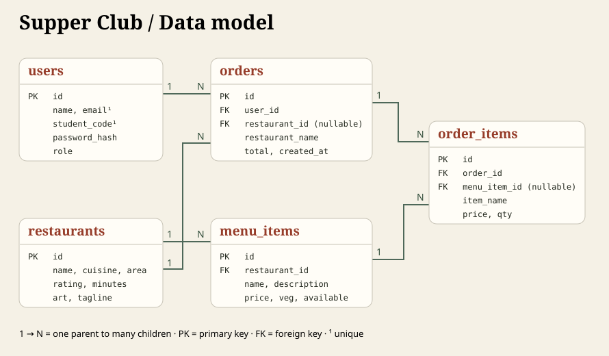
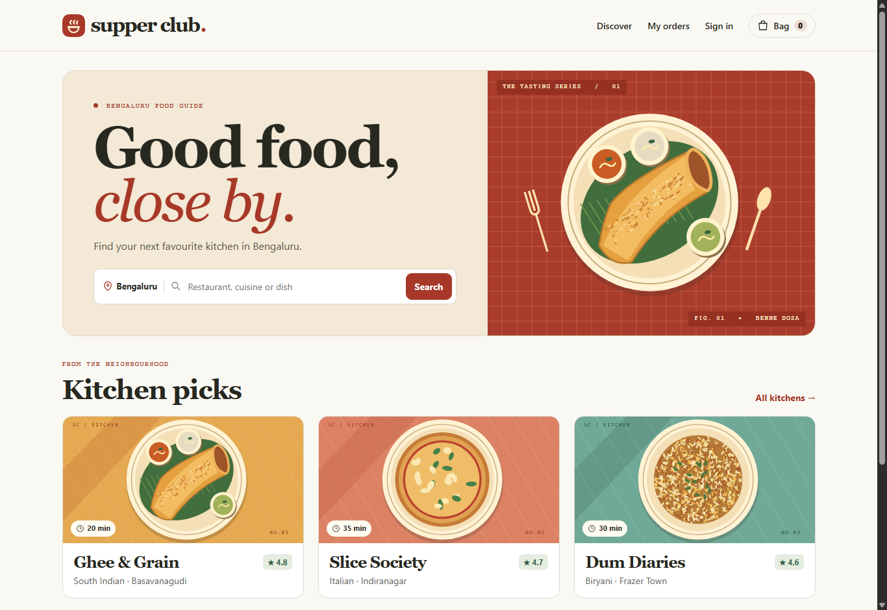
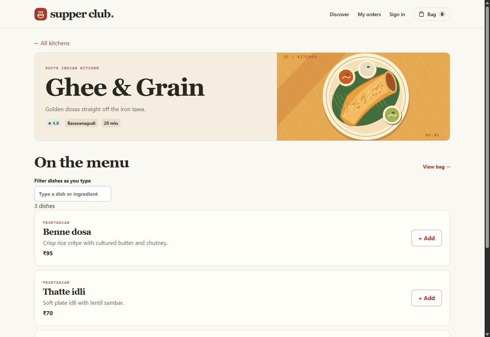
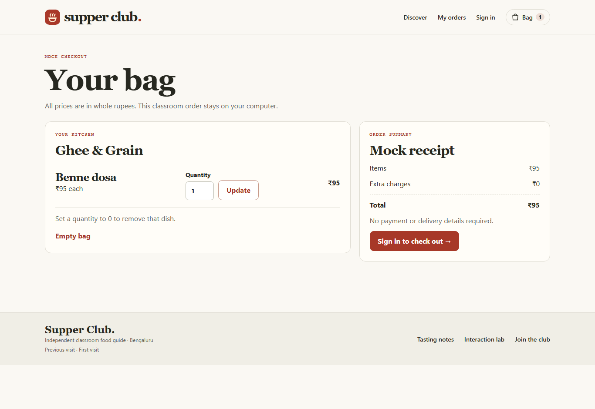

# Supper Club | Project report

## Objective and reference

The project recreates the discovery-to-order journey of a restaurant marketplace for a four-member web programming activity. A public Bengaluru listing on Zomato combines location and restaurant/cuisine/dish search, account links and a catalogue of restaurant names, ratings, cuisines and areas. Supper Club carries those information choices into a local classroom catalogue. [Reference listing](https://www.zomato.com/bangalore/restaurants)

The replica uses a red accent, fixed city label, responsive kitchen cards, short metadata and clear add-to-bag controls. The editorial wordmark, illustrated dishes and fictional restaurant names give the classroom project its own identity. A mock receipt replaces payment and delivery. Ratings and delivery times are sample values placed by the administrator. Site behaviour remains available offline once the local server is running.

## Architecture

```text
Browser: HTML5, CSS, JavaScript, session ID and previous-visit cookie
        │ GET pages and searches / POST forms with CSRF token
        ▼
public/index.php → session, page allowlist, access checks, shared layout
        ├─ views/ → escaped HTML forms, results, receipts and demo panels
        ├─ app/actions.php → validation, sign-in, bag, checkout
        ├─ app/admin.php → catalogue mutations
        │      └─ app/core.php → PDO prepared statements → MySQL / InnoDB
        └─ app/feedback.php → file lock → storage/feedback.txt
```

Public GET requests read menus and search results. State changes use POST. Successful writes redirect to a GET, so refreshing a receipt does not place another order. The PHP session holds the user role, CSRF token, bag quantities and post-login destination. Previous-visit information uses a separate 30-day cookie.

## Data model



- A restaurant owns many menu items. Removing a kitchen cascades to its current menu.
- A user owns many orders. An order records one restaurant and one or more purchased items.
- Each order item holds a price, quantity and display-name snapshot. Catalogue links on receipts are nullable and use `ON DELETE SET NULL`. Deleting a restaurant or dish preserves the historical receipt.
- Money uses integer rupees. The cart stores only item IDs and quantities in the session. The feedback store is separate from the five relational tables and associates notes with a numeric owner ID.

## Views and implementation

| View | What a student can demonstrate | Main implementation |
| --- | --- | --- |
| Home | City search, three kitchen picks, real cuisine links | `views/home.php` |
| Discover | Prepared SQL search across kitchens, areas, cuisines and dish names. A PHP associative array supplies the sort menu. `usort` handles rating or speed. | `views/discover.php` |
| Menu | Vegetarian labels, prices, sold-out state, instant ingredient/name filter and Add | `views/menu.php`, `public/assets/app.js` |
| Bag and checkout | Quantity limits, one-kitchen rule, removal, server-side total and transactional confirmation | `views/cart.php`, `app/actions.php` |
| Register and sign in | Client and server regex validation, unique identifiers and hashed passwords | `views/auth.php`, `app/core.php`, `app/actions.php` |
| My orders | Per-user receipts and accessible line-item tables | `views/orders.php` |
| Tasting notes | Private file create, read, update and delete, with owner checks | `views/feedback.php`, `app/feedback.php` |
| Interaction lab | Pointer coordinates, hover/tap/focus stacking, nested help lists and Escape | `views/lab.php`, `public/assets/app.js` |
| Catalogue desk | Restaurant and dish CRUD, sold-out toggles and price changes | `views/admin.php`, `app/admin.php` |

## Two ordering rules to explain at the viva

**One kitchen per bag.** The add action reads the menu item from MySQL, checks availability and compares its kitchen with the first item already in the bag. The user may change quantity from 0 (remove) through 10. A kitchen change requires an empty bag.

**Quote and commit.** Checkout authenticates the user, begins an InnoDB transaction, locks the selected items and recalculates the total. Missing, unavailable or repriced lines require review. It writes an order and all line items together, commits, then clears the bag. An error rolls back the entire transaction. A second submit against the cleared bag cannot create another order.

## Security and persistence

PDO binds user-supplied values. Sort options, illustration filenames and page templates use allowlists. Forms use session CSRF tokens. Registration uses `password_hash`; login uses `password_verify`, rotates the session ID and replaces the CSRF token. Logout destroys the session. Session cookies are HTTP-only and SameSite=Lax, with Secure enabled under HTTPS. Stored text is escaped during rendering. The admin role can be granted only by the local operator using the CLI. The website enforces the role again for each admin POST.

File feedback uses JSON-encoded text, a sidecar file lock and same-directory temporary-file replacement. Every read is filtered by session owner, and every edit/delete checks ownership. The public directory exposes only the front controller and static assets.

## Individual modification rehearsal

Each member should run the complete walkthrough in the README. Rotate who explains each change.

1. Change the student code format. Update the JavaScript and PHP expressions and hints, then review the SQL column length. Test both the normal form and a direct POST.
2. Add a sort choice. Extend the associative options and comparison function in discovery, then compare results against the seeded records.
3. Change the portion limit. Update the add action, quantity action and number field together, then exercise the boundary values.
4. Add a keyboard shortcut or change the mobile breakpoint. Use the lab and a narrow viewport to demonstrate the change. Identify the event handler or CSS rule before editing.

## Screenshots from the running application



The homepage links each card to its restaurant's live menu. The search combines kitchen, cuisine, area and dish matching.



The menu shows dish availability and prices from the local database. Its text filter also searches the dish description.



The example bag contains one ₹95 dosa. The guest signs in before confirming the mock order. The [screenshot guide](SCREENSHOTS.md) includes the full capture list and instructions for the comparison sheet.

